Clasificador de imágenes de pastelería con redes neuronales

Inteligencia Artificial II · Facultad de Ingeniería · Universidad Nacional de Cuyo

Trinidad Perea Enrico

# Resumen

Se implementó un clasificador de fotografías de pastelería en cinco clases (tarta, torta, cupcake, dona y macaron). Se comparó una CNN entrenada desde cero con MobileNetV2 preentrenada en ImageNet, primero con la base congelada y luego mediante fine-tuning. Sobre 1.250 imágenes de test, la CNN obtuvo 43,4% de accuracy y el modelo final 87,8%. Se integró el modelo en una interfaz Gradio. El ajuste fino no mejoró la accuracy de validación respecto de la etapa congelada.

# 1. Introducción y objetivos

El objetivo es aplicar aprendizaje supervisado de imágenes a una tarea concreta, comparar la generalización de diferentes estrategias de entrenamiento y analizar errores, no solo la exactitud global. El sistema devuelve una distribución softmax sobre cinco categorías conocidas; estas puntuaciones no garantizan probabilidades calibradas ni permiten detectar automáticamente objetos ajenos a las clases.

# 2. Fundamentos teóricos

## 2.1 Redes convolucionales

Una CNN aplica filtros compartidos sobre regiones locales de la imagen para aprender mapas de características. Las capas convolucionales extraen patrones visuales; ReLU aporta no linealidad; max pooling reduce resolución espacial; las capas densas combinan características para clasificar. El sobreajuste ocurre cuando el rendimiento en entrenamiento supera ampliamente al observado con datos no utilizados para ajustar pesos.

## 2.2 Transfer learning y MobileNetV2

Transfer learning reutiliza una representación visual aprendida en una tarea previa. MobileNetV2 es una CNN eficiente basada en bloques residuales invertidos y convoluciones separables en profundidad. Se cargaron pesos preentrenados en ImageNet, se retiró la clasificación original de 1.000 clases y se agregó una salida de cinco clases. Durante la primera etapa la red base permaneció congelada: solo aprendió la nueva cabeza.

## 2.3 Fine-tuning y regularización

En fine-tuning se habilitan parámetros de algunas capas preentrenadas para adaptarlas al dominio objetivo. Se usa una tasa de aprendizaje reducida para evitar cambios bruscos. Dropout, aumento de datos y early stopping son recursos para favorecer generalización. El aumento de datos se activa en entrenamiento, no en inferencia; el preprocesamiento de MobileNetV2 sí forma parte del flujo de predicción.

# 3. Dataset y preparación

Se utilizó Food-101 (Bossard et al., 2014), seleccionando:

\- apple_pie→Tarta

\- chocolate_cake→Torta

\- cup_cakes→Cupcake

\- donuts→Dona

\- macarons→Macaron

Cada clase aporta 750 imágenes oficiales de entrenamiento y 250 de test. Con random.seed(42), se mezclaron las rutas de cada clase y se separó el 85% para entrenamiento y el resto para validación, conservando el test oficial.

|               |           |       |
|---------------|-----------|-------|
| Conjunto      | Por clase | Total |
| Entrenamiento | 637       | 3.185 |
| Validación    | 113       | 565   |
| Test          | 250       | 1.250 |
| Total         | 1.000     | 5.000 |

Las imágenes se cargaron a 224 × 224 píxeles, en lotes de 32, mediante image_dataset_from_directory, con caché y prefetch. La categoría Torta corresponde específicamente a chocolate_cake, por lo que su alcance no incluye automáticamente cualquier tipo de torta.

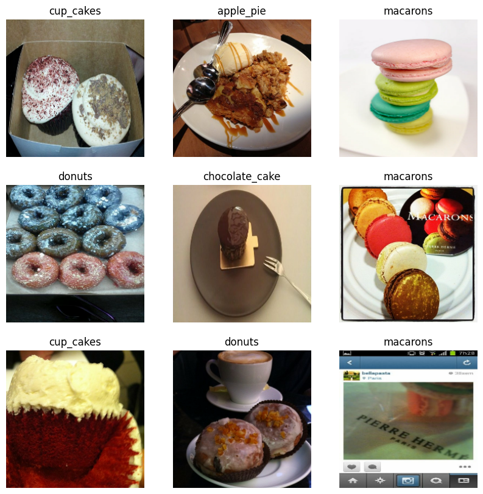

Figura 1. Ejemplos de imágenes del conjunto de entrenamiento.

# 4. Metodología experimental

## 4.1 CNN entrenada desde cero

Arquitectura: entrada RGB 224×224; reescalado 1/255; tres convoluciones 3×3 de 32, 64 y 128 filtros con ReLU y max pooling; Flatten; Dense(128, ReLU); Dropout(0,5); Dense(5, softmax). Se entrenó 15 épocas con Adam y sparse categorical crossentropy. Se utilizó como línea base para medir el efecto de reutilizar pesos preentrenados.

## 4.2 MobileNetV2 congelada

Se cargó MobileNetV2 (include_top=False, weights=imagenet), con base.trainable=False. La entrada pasa por RandomFlip(horizontal), RandomRotation(0,1), RandomZoom(0,15), RandomContrast(0,1), preprocess_input, MobileNetV2 llamada con training=False, GlobalAveragePooling2D, Dropout(0,3) y Dense(5, softmax). Se utilizó Adam con learning rate 10⁻³, hasta 15 épocas y EarlyStopping(patience=4, restore_best_weights=True); se registraron 9 épocas.

## 4.3 Ajuste fino

Se estableció base.trainable=True, congelando todas las capas salvo las últimas 30; se recompiló con Adam y learning rate 10⁻⁵. Se continuó hasta 10 épocas, con EarlyStopping(patience=3, restore_best_weights=True); se registraron 4 épocas. La base se sigue invocando con training=False, detalle relevante para el comportamiento de capas como BatchNormalization. El modelo final guardado corresponde a esta etapa.

# 5. Resultados y discusión

|                           |                 |            |           |
|---------------------------|-----------------|------------|-----------|
| Configuración             | Entrenamiento\* | Validación | Test      |
| CNN desde cero            | 87,8%           | 42,3%      | 43,4%     |
| MobileNetV2 congelada     | 85,5%           | 84,4%      | No medido |
| MobileNetV2 + fine-tuning | 83,9%           | 83,7%      | 87,8%     |

\* Las cifras de entrenamiento corresponden al último valor registrado en los historiales; las cifras de validación de la CNN y del modelo final se evaluaron con evaluate, mientras que 84,4% de la etapa congelada es el máximo de su historial. No son mediciones homogéneas de un mismo checkpoint, por lo que deben interpretarse con esa salvedad.

La CNN mostró sobreajuste: la accuracy de entrenamiento subió hasta 87,8% mientras validación quedó en 42,3%, y su pérdida de validación aumentó. MobileNetV2 congelada elevó la accuracy de validación a 84,4%, reduciendo ampliamente la brecha. Fine-tuning no mejoró validación: 83,7% frente a 84,4%. No puede afirmarse que haya mejorado el test frente al modelo congelado, porque ese checkpoint no fue evaluado por separado en test.

El modelo final obtuvo 1.097 aciertos de 1.250 (87,76%). Que test supere validación podría relacionarse con el ruido del conjunto de entrenamiento de Food-101, del que procede validación, pero esa explicación no fue comprobada experimentalmente.

Figura 2. Evolución de accuracy de los tres entrenamientos.

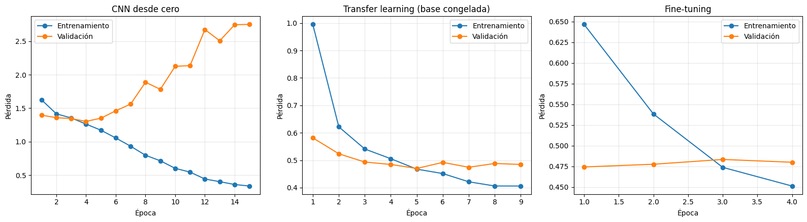

Figura 3. Evolución de loss de los tres entrenamientos.

Figura 4. Accuracy conjunta de transfer learning y fine-tuning; la línea marca el cambio de etapa.

## 5.1 Métricas por clase

|         |           |        |      |         |
|---------|-----------|--------|------|---------|
| Clase   | Precision | Recall | F1   | Soporte |
| Tarta   | 0,91      | 0,89   | 0,90 | 250     |
| Torta   | 0,91      | 0,82   | 0,86 | 250     |
| Cupcake | 0,77      | 0,92   | 0,84 | 250     |
| Dona    | 0,88      | 0,83   | 0,85 | 250     |
| Macaron | 0,94      | 0,92   | 0,93 | 250     |

Precision indica qué proporción de predicciones de una clase fueron correctas; recall, qué proporción de ejemplos reales de esa clase se detectaron; F1 es su media armónica. Cupcake tiene recall de 92% pero precision de aproximadamente 77%, porque absorbe predicciones erróneas de otras clases. Macaron presenta el mayor recall exacto (231/250 = 92,4%).

## 5.2 Matriz de confusión

Figura 5. Matriz de confusión del modelo final sobre el test oficial.

La diagonal suma 1.097 aciertos y fuera de ella hay 153 errores. De estos, 67 fueron predicciones erróneas como Cupcake: 8 tartas, 18 tortas, 27 donas y 14 macarons. La confusión dona→cupcake (27) es la más numerosa.

# 6. Interfaz y pruebas externas

La aplicación Gradio carga el modelo guardado y la traducción de etiquetas desde clases.json. Redimensiona la imagen a 224×224 y muestra la distribución de salida por clase. El preprocesamiento de MobileNetV2 ya está incorporado al modelo; por eso no se debe aplicar otra normalización externa incompatible.

# 7. Limitaciones y mejoras futuras

El clasificador solo conoce cinco clases, no cuenta con una clase “otro” y puede asignar alta puntuación a imágenes ajenas al dominio. Torta está representada únicamente por chocolate_cake; Food-101 no representa toda la diversidad de productos artesanales. Las fotografías propias pueden diferir en iluminación, encuadre y presentación. Se propone reunir un test externo etiquetado, ampliar clases (por ejemplo, alfajor), explorar mecanismos de rechazo y evaluar por separado el checkpoint congelado para completar la comparación.

# 8. Conclusiones

El experimento muestra que la reutilización de características de ImageNet fue más eficaz que entrenar una CNN simple desde cero con 3.185 imágenes: la primera presentó sobreajuste y 43,4% de accuracy en test, mientras que el modelo final basado en MobileNetV2 alcanzó 87,8%. La etapa congelada obtuvo 84,4% de accuracy de validación y el fine-tuning posterior 83,7%, sin mejora demostrada. El análisis por clase revela errores concentrados en Cupcake. La interfaz demuestra la integración del modelo en una aplicación funcional, aunque se requiere una evaluación externa sistemática para estimar su desempeño en pastelería real.

# Referencias

Bossard, L., Guillaumin, M. y Van Gool, L. (2014). Food-101: Mining Discriminative Components with Random Forests. ECCV.

Sandler, M., Howard, A., Zhu, M., Zhmoginov, A. y Chen, L.-C. (2018). MobileNetV2: Inverted Residuals and Linear Bottlenecks. CVPR.

TensorFlow/Keras: documentación de MobileNetV2, image_dataset_from_directory y EarlyStopping. Gradio: documentación de interfaz de clasificación.

# 

---

# Extensión del proyecto: Vision Transformer (ViT)

## 1. Introducción y objetivo

Como extensión del proyecto de clasificación de imágenes de pastelería, se incorporó una arquitectura basada en Vision Transformers (ViT), con el objetivo de explorar una alternativa a las redes neuronales convolucionales implementadas originalmente.

El propósito de esta extensión es evaluar el rendimiento de una arquitectura basada en mecanismos de atención, analizar su capacidad de generalización y comparar los resultados obtenidos con los modelos anteriores.

Además, se incorporaron técnicas de visualización que permiten explorar el funcionamiento interno del Transformer y comprender las diferencias en el procesamiento de imágenes respecto de las arquitecturas convolucionales.

El desarrollo se realizó en un notebook independiente, denominado `VisionTransformer.ipynb`, utilizando PyTorch y la biblioteca `timm`. De esta manera, se conservó la implementación original del proyecto y su aplicación de clasificación.

## 2. Fundamentos teóricos

### 2.1. Vision Transformer

Vision Transformer (ViT) es una arquitectura de aprendizaje profundo presentada por Dosovitskiy et al. en el trabajo *An Image is Worth 16x16 Words: Transformers for Image Recognition at Scale*.

Esta arquitectura adapta los Transformers, utilizados inicialmente en tareas de procesamiento del lenguaje natural, a problemas de visión por computadora.

A diferencia de las redes neuronales convolucionales (CNN), que utilizan filtros para extraer características espaciales, Vision Transformer divide la imagen en pequeños fragmentos denominados patches y los procesa como una secuencia de elementos.

Su funcionamiento puede resumirse en las siguientes etapas:

1. **División en patches:** la imagen se divide en fragmentos de tamaño fijo.
2. **Patch Embedding:** cada fragmento se transforma en una representación vectorial.
3. **Positional Embedding:** se incorpora información sobre la posición espacial de cada fragmento.
4. **Transformer Encoder:** los embeddings son procesados mediante bloques Transformer.
5. **Clasificación:** la representación final del token CLS se utiliza para determinar la categoría correspondiente.

El flujo de procesamiento puede representarse de la siguiente manera:

**Imagen → Patches → Embeddings → Transformer Encoder → Clasificación**

### 2.2. Self-Attention

El mecanismo de Self-Attention permite establecer relaciones entre los diferentes elementos de una secuencia.

En el caso de Vision Transformer, estos elementos representan distintas regiones de una imagen.

Para calcular la atención, cada token se transforma en tres representaciones:

- **Query (Q):** representa la información que busca un token.
- **Key (K):** representa la información con la que se compara cada Query.
- **Value (V):** representa la información que se combina según los pesos de atención obtenidos.

El mecanismo de atención se expresa mediante la siguiente ecuación:

$$
Attention(Q,K,V) =
softmax\left(\frac{QK^T}{\sqrt{d_k}}\right)V
$$

Esto permite que cada token incorpore información proveniente de otras regiones de la imagen, independientemente de la distancia espacial entre ellas.

### 2.3. Multi-Head Attention

Vision Transformer utiliza múltiples cabezas de atención dentro de cada bloque.

Cada cabeza puede aprender diferentes relaciones entre los tokens, permitiendo procesar simultáneamente distintos aspectos de la imagen.

Por ejemplo, algunas cabezas podrían representar relaciones vinculadas con formas, texturas, colores o estructuras espaciales.

La combinación de estas representaciones permite obtener características visuales más complejas.

### 2.4. Diferencias respecto de las CNN

| Característica | CNN | Vision Transformer |
|---|---|---|
| Unidad principal de procesamiento | Regiones de píxeles | Patches |
| Extracción de características | Filtros convolucionales | Mecanismos de atención |
| Relaciones espaciales | Principalmente locales en cada convolución | Globales mediante Self-Attention |
| Información posicional | Implícita en la estructura espacial | Positional Embeddings |
| Procesamiento | Mapas de características | Secuencia de tokens |
| Interpretabilidad | Mapas de activación, Grad-CAM | Attention Maps, Attention Rollout |

Mientras que las CNN construyen representaciones jerárquicas mediante operaciones convolucionales, Vision Transformer permite establecer relaciones directas entre diferentes regiones de la imagen mediante mecanismos de atención.

## 3. Arquitectura seleccionada

Para esta extensión se utilizó el modelo preentrenado `vit_base_patch16_224`, disponible mediante la biblioteca `timm`.

Las principales características de la arquitectura seleccionada son:

| Característica | Valor |
|---|---|
| Arquitectura | ViT-Base/16 |
| Tamaño de entrada | 224 × 224 píxeles |
| Canales de entrada | 3 (RGB) |
| Tamaño de cada patch | 16 × 16 píxeles |
| Cantidad de patches | 196 |
| Dimensión de los embeddings | 768 |
| Bloques Transformer | 12 |
| Cabezas de atención por bloque | 12 |
| Cantidad total de tokens | 197 |
| Clases de salida | 5 |

Cada imagen de entrada se divide en una cuadrícula de 14 × 14, obteniendo un total de 196 patches.

A estos fragmentos se les incorpora un token especial denominado CLS (Classification Token), obteniendo una secuencia de 197 tokens.

La representación final de este token es utilizada por la cabeza de clasificación para determinar a cuál de las cinco categorías pertenece la imagen.

## 4. Preparación del dataset

Para mantener la continuidad con el proyecto original, se utilizaron las cinco categorías seleccionadas del dataset Food-101:

- `apple_pie`: Tarta.
- `chocolate_cake`: Torta.
- `cup_cakes`: Cupcake.
- `donuts`: Dona.
- `macarons`: Macaron.

Se mantuvo la organización del dataset en tres conjuntos independientes:

- Entrenamiento (`dataset/train`).
- Validación (`dataset/val`).
- Prueba (`dataset/test`).

### 4.1. Preprocesamiento

Las imágenes fueron adaptadas a los requerimientos de entrada del modelo Vision Transformer.

Las transformaciones realizadas fueron:

- Redimensionamiento a 224 × 224 píxeles.
- Conversión de las imágenes a tensores.
- Normalización según los parámetros del modelo preentrenado.

Los parámetros de normalización utilizados fueron:

| Parámetro | Valores RGB |
|---|---|
| Media | (0.5, 0.5, 0.5) |
| Desviación estándar | (0.5, 0.5, 0.5) |

Estos valores fueron obtenidos mediante la configuración del modelo proporcionada por la biblioteca `timm`.

### 4.2. Data Augmentation

Durante el entrenamiento se aplicó una técnica de aumento de datos mediante inversión horizontal aleatoria (`RandomHorizontalFlip`).

El objetivo de esta transformación fue introducir variabilidad en las imágenes y reducir la dependencia del modelo respecto de una orientación específica.

Los conjuntos de validación y prueba no recibieron transformaciones aleatorias, permitiendo realizar una evaluación consistente.

## 5. Transfer Learning

Debido al tamaño del dataset y a la complejidad computacional de Vision Transformer, se optó por utilizar Transfer Learning en lugar de entrenar la arquitectura desde cero.

Esta estrategia permite aprovechar las representaciones visuales adquiridas previamente por el modelo durante su preentrenamiento.

Para adaptar Vision Transformer al problema de clasificación de pastelería se realizaron los siguientes pasos:

1. Carga del modelo ViT-Base/16 con pesos preentrenados.
2. Adaptación de la cabeza de clasificación a cinco clases de salida.
3. Congelamiento de los parámetros de la arquitectura base.
4. Entrenamiento exclusivo de la cabeza de clasificación.
5. Evaluación del rendimiento sobre validación y prueba.

De esta manera, los parámetros de los bloques Transformer permanecieron congelados durante el entrenamiento.

Esta estrategia se conoce como extracción de características mediante Transfer Learning.

A diferencia del fine-tuning, no se modificaron los pesos internos de la arquitectura preentrenada.

## 6. Configuración del entrenamiento

El entrenamiento fue realizado utilizando PyTorch y aceleración mediante GPU (CUDA) en Google Colab.

La configuración utilizada fue la siguiente:

| Parámetro | Valor |
|---|---|
| Framework | PyTorch |
| Biblioteca de modelos | timm |
| Modelo | vit_base_patch16_224 |
| Optimizador | AdamW |
| Función de pérdida | CrossEntropyLoss |
| Learning rate | 0.001 |
| Batch size de entrenamiento | 32 |
| Batch size de validación y prueba | 64 |
| Épocas máximas | 15 |
| Paciencia de Early Stopping | 4 |
| Semilla aleatoria de PyTorch | 42 |
| Dispositivo | GPU mediante CUDA |

### 6.1. Early Stopping

Se implementó una estrategia de parada temprana (Early Stopping) utilizando la pérdida de validación como criterio de selección del mejor modelo.

El entrenamiento se configuró para detenerse cuando la pérdida de validación no presentara mejoras durante cuatro épocas consecutivas.

Los resultados obtenidos durante el entrenamiento fueron:

| Época | Accuracy entrenamiento | Accuracy validación | Loss validación |
|---|---:|---:|---:|
| 1 | 86,8 % | 92,0 % | 0,243 |
| 2 | 94,3 % | 93,5 % | 0,210 |
| 3 | 95,9 % | 94,0 % | 0,194 |
| 4 | 97,0 % | 94,3 % | 0,194 |
| **5** | **97,7 %** | **94,7 %** | **0,188** |
| 6 | 98,1 % | 95,0 % | 0,197 |
| 7 | 98,6 % | 94,9 % | 0,194 |
| 8 | 98,7 % | 94,7 % | 0,198 |
| 9 | 98,9 % | 95,2 % | 0,202 |

El entrenamiento finalizó después de nueve épocas.

La menor pérdida de validación se obtuvo en la época cinco, por lo que se recuperaron los pesos correspondientes a dicha época.

Aunque el mayor accuracy de validación se obtuvo en la época nueve, el criterio utilizado para seleccionar el mejor modelo fue la pérdida de validación.

## 7. Análisis de las curvas de aprendizaje

### 7.1. Accuracy

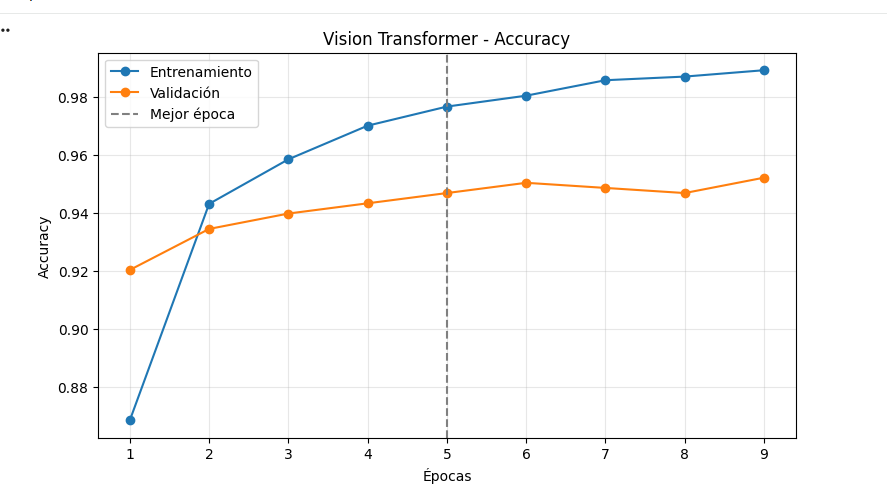

*Figura: Evolución del accuracy durante el entrenamiento y la validación.*

Se observa un incremento considerable del accuracy durante las primeras épocas.

Desde la primera época, el modelo alcanzó un accuracy de validación del 92 %, lo que demuestra la utilidad de las representaciones visuales adquiridas durante el preentrenamiento para este problema.

El accuracy de entrenamiento continuó aumentando hasta alcanzar un 98,9 %, mientras que el accuracy de validación se estabilizó alrededor del 95 %.

La diferencia creciente entre ambas curvas constituye un indicio de sobreajuste hacia las últimas épocas.

### 7.2. Loss

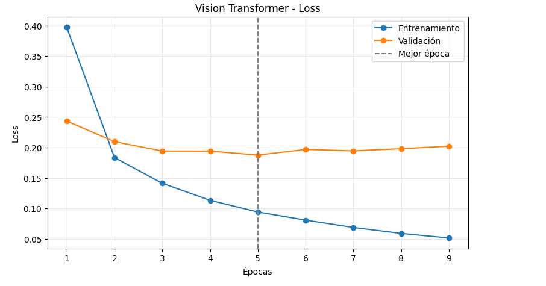

*Figura: Evolución de la función de pérdida durante el entrenamiento y la validación.*

Durante las primeras cinco épocas, la pérdida disminuyó tanto en entrenamiento como en validación.

A partir de la quinta época, la pérdida de entrenamiento continuó disminuyendo, mientras que la pérdida de validación presentó un ligero incremento.

Este comportamiento indica que el modelo continuó ajustándose a los datos de entrenamiento sin conseguir una mejora equivalente sobre los datos de validación.

La utilización de Early Stopping permitió recuperar los pesos asociados a la menor pérdida de validación y limitar el sobreajuste.

## 8. Evaluación del modelo

El modelo fue evaluado sobre el conjunto de prueba, compuesto por 1.250 imágenes distribuidas equitativamente entre las cinco categorías.

Estas imágenes no participaron en el entrenamiento ni en la selección de los mejores pesos.

### 8.1. Resultados generales

| Métrica | Resultado |
|---|---:|
| Accuracy de entrenamiento en la mejor época | 97,70 % |
| Accuracy de validación en la mejor época | 94,70 % |
| **Accuracy de test** | **96,72 %** |
| Test Loss | 0,1078 |
| Precision macro | 96,75 % |
| Recall macro | 96,72 % |
| F1-score macro | 96,72 % |
| Imágenes evaluadas | 1.250 |
| Imágenes correctamente clasificadas | 1.209 |
| Imágenes incorrectamente clasificadas | 41 |
| Porcentaje de error | 3,28 % |

Los resultados muestran un elevado rendimiento sobre el conjunto de prueba, incluso sin realizar fine-tuning de los bloques internos del Transformer.

### 8.2. Reporte de clasificación

| Categoría | Precision | Recall | F1-score | Support |
|---|---:|---:|---:|---:|
| Tarta | 99,17 % | 95,20 % | 97,14 % | 250 |
| Torta | 96,05 % | 97,20 % | 96,62 % | 250 |
| Cupcake | 94,16 % | 96,80 % | 95,46 % | 250 |
| Dona | 96,39 % | 96,00 % | 96,19 % | 250 |
| Macaron | 98,01 % | 98,40 % | 98,20 % | 250 |
| **Macro Average** | **96,75 %** | **96,72 %** | **96,72 %** | **1.250** |

La categoría Macaron presentó el mayor rendimiento en términos de recall y F1-score.

Por otro lado, la categoría Tarta presentó la mayor cantidad de imágenes incorrectamente clasificadas, aunque obtuvo la mayor precision.

Esto indica que, cuando el modelo predice que una imagen corresponde a una tarta, generalmente realiza una clasificación correcta, aunque algunas tartas reales son clasificadas dentro de otras categorías.

## 9. Matriz de confusión

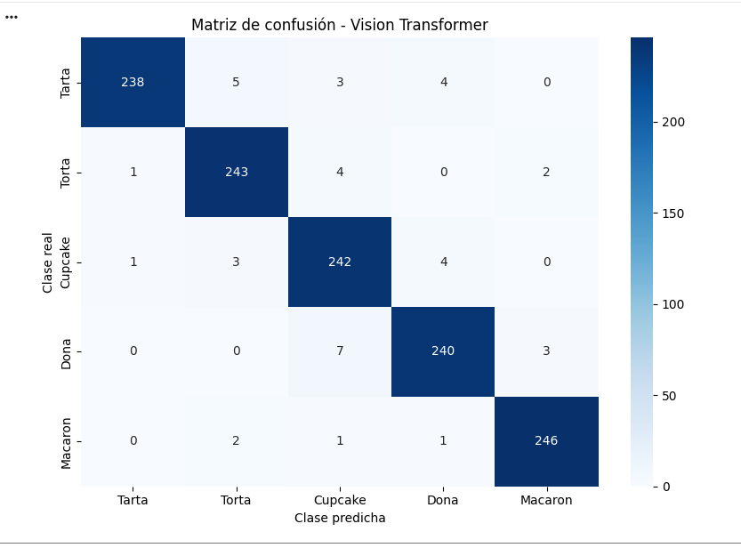

*Figura: Matriz de confusión obtenida sobre el conjunto de prueba.*

La matriz de confusión presenta una marcada concentración de valores sobre la diagonal principal, indicando un elevado número de clasificaciones correctas.

| Categoría | Aciertos | Errores |
|---|---:|---:|
| Tarta | 238 | 12 |
| Torta | 243 | 7 |
| Cupcake | 242 | 8 |
| Dona | 240 | 10 |
| Macaron | 246 | 4 |
| **Total** | **1.209** | **41** |

Las principales confusiones identificadas fueron:

- 7 donas clasificadas como cupcakes.
- 5 tartas clasificadas como tortas.
- 4 tartas clasificadas como donas.
- 4 cupcakes clasificados como donas.
- 4 tortas clasificadas como cupcakes.

Estas confusiones podrían estar relacionadas con similitudes visuales entre los productos, especialmente en sus formas, coberturas, decoraciones y presentaciones.

## 10. Visualización de predicciones

Con el objetivo de complementar el análisis cuantitativo, se visualizaron ejemplos de imágenes correctamente clasificadas e incorrectamente clasificadas.

Para cada imagen se presentó:

- Categoría real.
- Categoría predicha.
- Confianza asignada mediante Softmax.

Se seleccionaron seis ejemplos correctos y seis incorrectos para facilitar el análisis visual de ambos casos.

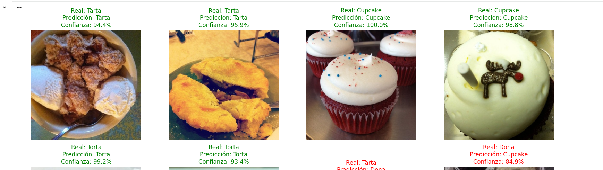
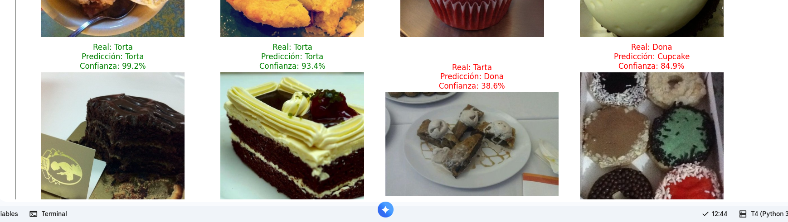

*Figura: Ejemplos de clasificaciones correctas e incorrectas.*

El modelo logró reconocer productos con diferentes formas, decoraciones, fondos y presentaciones.

Entre las predicciones incorrectas se identificaron casos interesantes, como una tarta clasificada como dona con una confianza del 38,6 % y una dona clasificada como cupcake con una confianza del 84,9 %.

El segundo caso demuestra que una predicción con una confianza elevada no necesariamente corresponde a una clasificación correcta.

Por lo tanto, los valores obtenidos mediante Softmax deben interpretarse como puntuaciones de confianza del modelo y no como garantías de acierto.

## 11. Visualización del funcionamiento interno de Vision Transformer

Una de las principales diferencias respecto de los modelos implementados originalmente es la utilización de mecanismos de atención.

Para explorar el funcionamiento interno de la arquitectura se implementaron tres visualizaciones:

- Visualización de patches.
- Attention Map.
- Attention Rollout.

### 11.1. Visualización de patches

Vision Transformer divide cada imagen de entrada en pequeños fragmentos de tamaño fijo.

En la arquitectura seleccionada, las imágenes de 224 × 224 píxeles se dividen en patches de 16 × 16 píxeles.

La cantidad de patches se calcula de la siguiente manera:

$$
N = \left(\frac{224}{16}\right)^2 = 196
$$

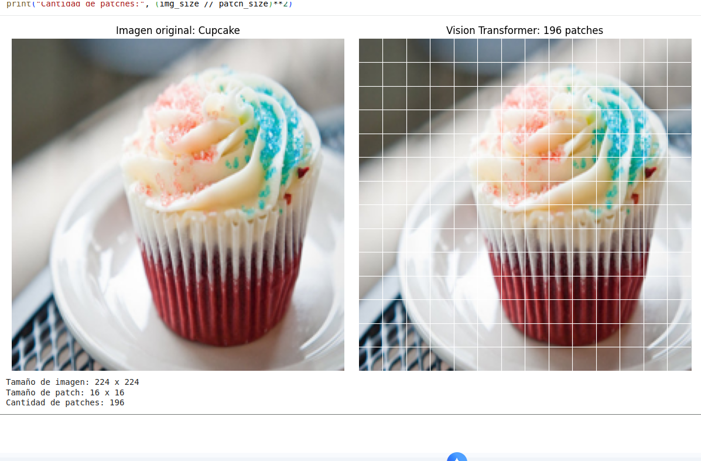

*Figura: Representación de una imagen de cupcake dividida en 196 patches.*

La figura permite observar cómo se divide espacialmente la imagen antes de ser procesada por el Transformer.

Cada fragmento se transforma en un embedding de dimensión 768 y recibe información posicional.

Posteriormente, los embeddings son procesados mediante los bloques Transformer, permitiendo establecer relaciones entre las diferentes regiones de la imagen.

Esta visualización representa la división espacial de la imagen y no los valores internos de los embeddings.

### 11.2. Attention Map

Para analizar el mecanismo de Self-Attention se extrajeron los pesos de atención del último bloque del Vision Transformer.

El procedimiento realizado consistió en:

1. Capturar la matriz de atención del último bloque mediante forward hooks de PyTorch.
2. Promediar las 12 cabezas de atención.
3. Extraer la atención asignada por el token CLS a los 196 patches.
4. Reconstruir la cuadrícula espacial de 14 × 14.
5. Redimensionar y normalizar el mapa obtenido.
6. Superponer el mapa de calor sobre la imagen original.

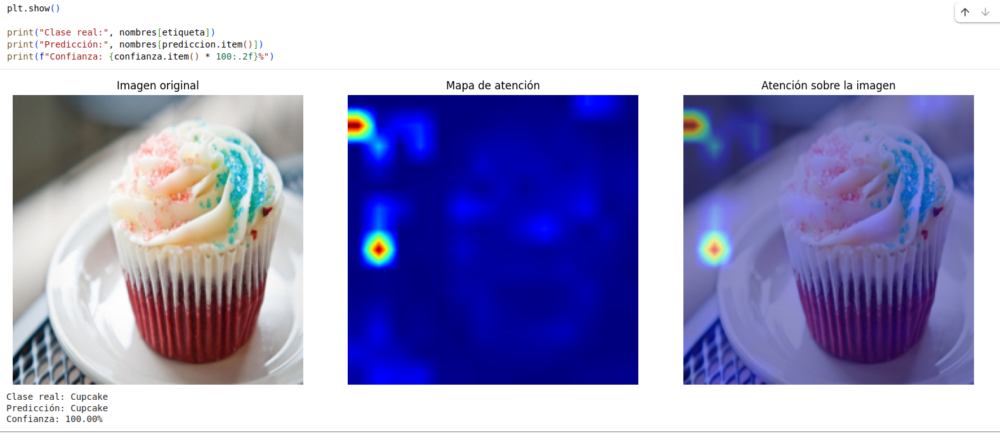

*Figura: Visualización de los pesos de atención del último bloque Transformer.*

Los colores cálidos representan regiones con mayores pesos relativos de atención, mientras que los colores fríos representan regiones con menores pesos.

En el ejemplo analizado, el modelo clasificó correctamente la imagen como Cupcake con una confianza que, redondeada a dos decimales, alcanzó el 100 %.

Sin embargo, algunas regiones del fondo presentaron mayores pesos de atención que el propio producto.

Este comportamiento puede relacionarse con el hecho de que los tokens del último bloque ya contienen información procesada por los bloques anteriores.

Por lo tanto, los pesos de atención de un único bloque no necesariamente representan de manera directa las regiones responsables de la clasificación final.

### 11.3. Attention Rollout

Con el objetivo de obtener una representación más global del mecanismo de atención, se implementó la técnica Attention Rollout.

A diferencia del mapa de atención anterior, esta técnica combina las matrices de atención de los 12 bloques del Vision Transformer.

Además, incorpora las conexiones residuales de la arquitectura para estimar la propagación de la atención entre los diferentes bloques.

El procedimiento realizado fue:

1. Capturar las matrices de atención de los 12 bloques Transformer.
2. Promediar las cabezas de atención de cada bloque.
3. Incorporar las conexiones residuales mediante una matriz identidad.
4. Normalizar las matrices de atención.
5. Multiplicar las matrices de forma acumulativa.
6. Extraer la atención acumulada del token CLS.
7. Generar un mapa de calor sobre la imagen original.

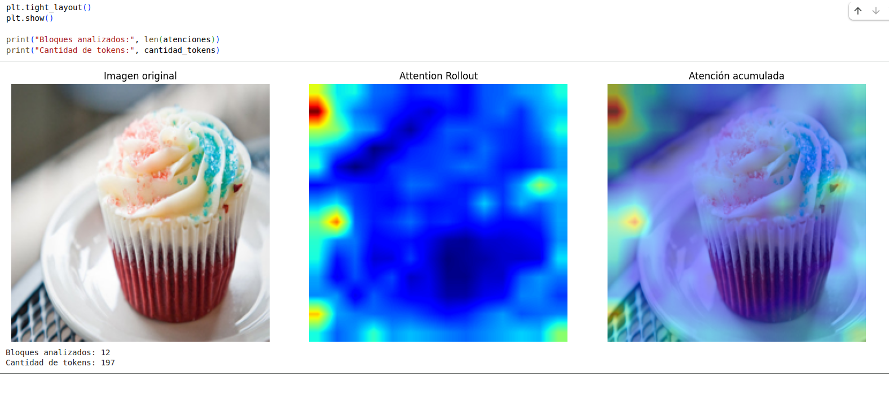

*Figura: Visualización de la atención acumulada a través de los 12 bloques Transformer.*

Se analizaron los 12 bloques de la arquitectura y los 197 tokens correspondientes a los 196 patches y al token CLS.

En comparación con el mapa de atención del último bloque, Attention Rollout presentó una distribución de atención más amplia, incluyendo algunas regiones del producto, sus bordes y su entorno.

Sin embargo, las regiones de mayor atención relativa continuaron concentrándose principalmente en el fondo.

Este resultado permite identificar una limitación de las técnicas de visualización utilizadas: los pesos de atención no constituyen necesariamente una explicación causal de las predicciones realizadas por el modelo.

### 11.4. Comparación de las técnicas de atención

| Característica | Attention Map | Attention Rollout |
|---|---|---|
| Bloques analizados | Último bloque | 12 bloques |
| Cabezas por bloque | 12 | 12 |
| Tipo de atención | Directa | Acumulada |
| Conexiones residuales | No consideradas explícitamente | Consideradas |
| Distribución observada | Concentrada | Más distribuida |
| Alcance del análisis | Parcial | Global |

Ambas técnicas permiten explorar el funcionamiento interno del Transformer desde diferentes perspectivas.

Su incorporación complementa las métricas tradicionales de evaluación, aunque no permite determinar de manera definitiva qué regiones causaron una clasificación específica.

## 12. Comparación con los modelos implementados originalmente

Con el objetivo de evaluar el aporte de Vision Transformer al proyecto, se compararon los resultados obtenidos con las configuraciones desarrolladas originalmente:

- CNN entrenada desde cero.
- MobileNetV2 con la base congelada.
- MobileNetV2 con fine-tuning.
- Vision Transformer con la base congelada.

### 12.1. Comparación general de resultados

| Modelo | Accuracy entrenamiento | Accuracy validación | Accuracy test |
|---|---:|---:|---:|
| CNN desde cero | 87,8 % | 42,3 % | 43,4 % |
| MobileNetV2 congelada | 85,5 % | 84,4 % | No medido |
| MobileNetV2 + Fine-Tuning | 83,9 % | 83,7 % | 87,76 % |
| **Vision Transformer** | **97,7 %** | **94,7 %** | **96,72 %** |

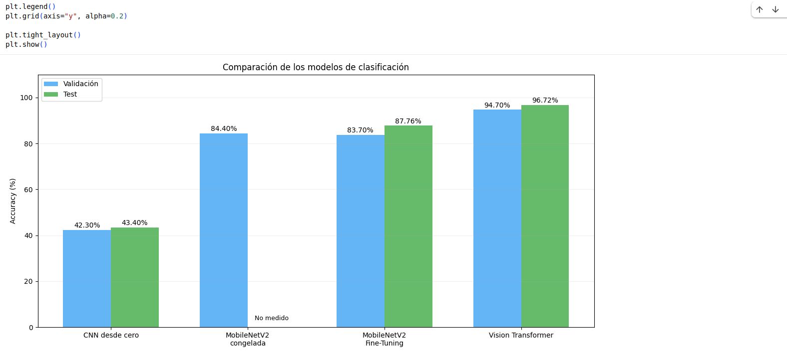

*Figura: Comparación del accuracy de validación y prueba de las configuraciones implementadas.*

Los resultados muestran una mejora considerable respecto de la CNN entrenada desde cero.

La utilización de modelos preentrenados mediante Transfer Learning permitió obtener representaciones visuales más adecuadas para el problema de clasificación.

Vision Transformer obtuvo el mayor accuracy de validación reportado y el mayor accuracy de prueba entre las configuraciones evaluadas sobre test.

### 12.2. Comparación con MobileNetV2 + Fine-Tuning

MobileNetV2 con fine-tuning fue el modelo seleccionado originalmente para la aplicación de clasificación de pastelería.

Por este motivo, se realizó una comparación específica entre dicha configuración y Vision Transformer.

| Métrica | MobileNetV2 + Fine-Tuning | Vision Transformer |
|---|---:|---:|
| Accuracy de test | 87,76 % | **96,72 %** |
| Imágenes evaluadas | 1.250 | 1.250 |
| Imágenes correctamente clasificadas | 1.097 | **1.209** |
| Imágenes incorrectamente clasificadas | 153 | **41** |
| Porcentaje de error | 12,24 % | **3,28 %** |

La diferencia de accuracy entre ambos modelos fue:

$$
96,72 - 87,76 = 8,96
$$

Vision Transformer obtuvo una mejora de **8,96 puntos porcentuales** respecto del modelo final del proyecto original.

Además, clasificó correctamente 112 imágenes adicionales.

La reducción relativa de errores fue:

$$
\frac{153-41}{153}\times100 = 73,20\%
$$

Esto representa una reducción aproximada del **73,2 % en la cantidad de errores de clasificación**.

Un aspecto relevante es que estos resultados fueron obtenidos sin realizar fine-tuning de los bloques Transformer, entrenando únicamente la cabeza de clasificación.

### 12.3. Comparación del rendimiento por categoría

Para analizar si la mejora fue generalizada o se concentró en determinadas categorías, se compararon los valores de recall reportados para ambos modelos.

| Categoría | MobileNetV2 + Fine-Tuning | Vision Transformer | Mejora aproximada |
|---|---:|---:|---:|
| Tarta | 89,0 % | 95,2 % | +6,2 pp |
| Torta | 82,0 % | 97,2 % | +15,2 pp |
| Cupcake | 92,0 % | 96,8 % | +4,8 pp |
| Dona | 83,0 % | 96,0 % | +13,0 pp |
| Macaron | 92,4 % | 98,4 % | +6,0 pp |

*pp: puntos porcentuales.*

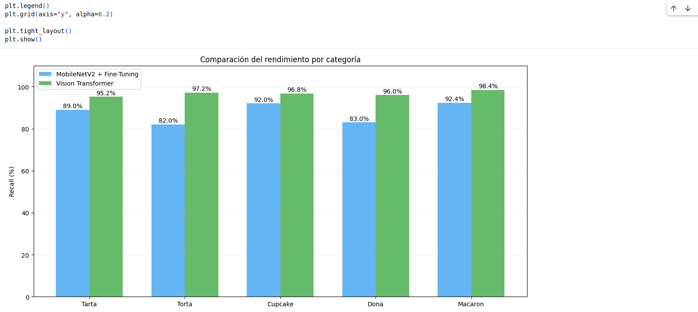

*Figura: Comparación del rendimiento por categoría entre MobileNetV2 con fine-tuning y Vision Transformer.*

A partir de los valores reportados, se observa que Vision Transformer presentó mejoras en las cinco categorías del problema.

Las mejoras más significativas se produjeron en las categorías:

- **Torta:** incremento aproximado de 15,2 puntos porcentuales.
- **Dona:** incremento aproximado de 13 puntos porcentuales.

Estas categorías presentaban mayores dificultades en el modelo original.

Los resultados sugieren que las representaciones visuales del Transformer preentrenado permitieron distinguir con mayor eficacia las características de los diferentes productos de pastelería.

### 12.4. Comparación de las estrategias de entrenamiento

| Característica | CNN desde cero | MobileNetV2 congelada | MobileNetV2 Fine-Tuning | Vision Transformer |
|---|---|---|---|---|
| Arquitectura | CNN | CNN | CNN | Transformer |
| Modelo preentrenado | No | Sí | Sí | Sí |
| Transfer Learning | No | Sí | Sí | Sí |
| Fine-Tuning | No aplica | No | Sí | No |
| Parámetros entrenados | Toda la red | Cabeza | Cabeza y últimas capas | Cabeza |
| Extracción de características | Convoluciones | Convoluciones | Convoluciones | Self-Attention |
| Accuracy de test | 43,4 % | No medido | 87,76 % | 96,72 % |

Vision Transformer presentó el mejor rendimiento de prueba registrado, a pesar de que sus bloques internos permanecieron congelados.

Esto demuestra la utilidad de las características visuales adquiridas durante su preentrenamiento para el problema estudiado.

### 12.5. Ventajas y desventajas de Vision Transformer

Entre las principales ventajas observadas se encuentran:

- Mayor accuracy sobre el conjunto de prueba.
- Menor cantidad de errores de clasificación.
- Mejores valores de recall reportados para las cinco categorías.
- Capacidad de establecer relaciones globales entre regiones de la imagen.
- Aprovechamiento de representaciones preentrenadas mediante Transfer Learning.
- Posibilidad de explorar los mecanismos de atención mediante visualizaciones.

Sin embargo, Vision Transformer también presenta algunas desventajas:

- Mayor tamaño del modelo respecto de MobileNetV2.
- Mayores requerimientos computacionales potenciales.
- Mayor complejidad arquitectónica.
- Dificultad para interpretar directamente los pesos de atención.
- Dependencia de modelos preentrenados para obtener buenos resultados con datasets relativamente pequeños.

Por lo tanto, aunque Vision Transformer presentó un mayor rendimiento predictivo en este experimento, MobileNetV2 continúa siendo una alternativa interesante para aplicaciones que requieren modelos livianos y eficientes.

### 12.6. Limitaciones de la comparación

La comparación realizada presenta algunas limitaciones que deben considerarse al interpretar los resultados.

En primer lugar, los modelos utilizan diferentes arquitecturas, pesos preentrenados, optimizadores y estrategias de aumento de datos.

Por este motivo, las mejoras observadas no pueden atribuirse exclusivamente al mecanismo de Self-Attention.

En segundo lugar, MobileNetV2 con la base congelada no fue evaluada de manera independiente sobre el conjunto de prueba.

Asimismo, los valores de entrenamiento y validación reportados no necesariamente corresponden a un criterio homogéneo de selección de pesos en todas las configuraciones.

La comparación utiliza las métricas registradas en el proyecto original y en la extensión. Para garantizar una comparación estrictamente equivalente, es necesario verificar que las particiones contengan exactamente las mismas imágenes.

Los valores de recall del modelo original también deben considerarse aproximados debido al redondeo de las métricas reportadas.

Finalmente, no se realizaron mediciones específicas del tiempo de inferencia, consumo de memoria ni utilización de recursos computacionales.

Por lo tanto, los resultados permiten comparar el rendimiento predictivo observado, pero no determinar cuál de las arquitecturas presenta una mayor eficiencia computacional.

## 13. Conclusión de la extensión

La incorporación de Vision Transformer permitió ampliar el proyecto original mediante la implementación de una arquitectura de aprendizaje profundo basada en mecanismos de atención.

Utilizando Transfer Learning y entrenando únicamente la cabeza de clasificación, se obtuvo un accuracy del 96,72 % sobre el conjunto de prueba, clasificando correctamente 1.209 de las 1.250 imágenes evaluadas.

En comparación con MobileNetV2 con fine-tuning, se obtuvo una mejora de 8,96 puntos porcentuales y una reducción aproximada del 73,2 % en la cantidad de errores.

Los resultados evidencian la utilidad de las representaciones visuales de un Transformer preentrenado para adaptarse a un problema de clasificación específico.

Además, la visualización de patches, Attention Maps y Attention Rollout permitió explorar el funcionamiento interno de la arquitectura y analizar algunas de sus diferencias respecto de las redes neuronales convolucionales.

A pesar de los resultados obtenidos, Vision Transformer presenta una arquitectura de mayor tamaño y complejidad que MobileNetV2, por lo que su incorporación a una aplicación debe considerar tanto el rendimiento predictivo como los recursos computacionales disponibles.

Esta extensión complementa el proyecto original sin modificar los modelos previamente desarrollados ni la aplicación existente, permitiendo incorporar una nueva perspectiva sobre las técnicas actuales de clasificación de imágenes.

## 14. Trabajos futuros

A partir de los resultados obtenidos, se proponen las siguientes posibles extensiones:

- Realizar fine-tuning de los últimos bloques del Vision Transformer.
- Evaluar variantes más livianas, como ViT-Tiny o ViT-Small.
- Comparar los tiempos de entrenamiento e inferencia de las arquitecturas.
- Analizar el consumo de memoria y los requerimientos computacionales.
- Incorporar técnicas adicionales de interpretabilidad.
- Evaluar la capacidad de generalización utilizando imágenes externas al dataset Food-101.
- Incorporar Vision Transformer como modelo alternativo dentro de la aplicación de clasificación.

## 15. Referencias bibliográficas adicionales

- Dosovitskiy, A. et al. (2021). *An Image is Worth 16x16 Words: Transformers for Image Recognition at Scale*. International Conference on Learning Representations (ICLR).

- Vaswani, A. et al. (2017). *Attention Is All You Need*. Advances in Neural Information Processing Systems.

- Abnar, S. y Zuidema, W. (2020). *Quantifying Attention Flow in Transformers*. Proceedings of the Annual Meeting of the Association for Computational Linguistics.

- Wightman, R. (2019). *PyTorch Image Models (timm)*.
