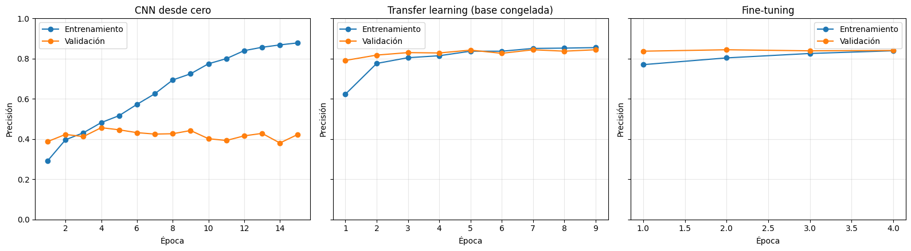
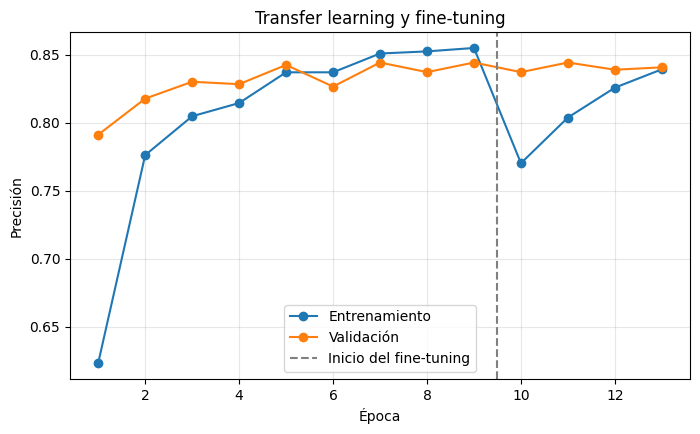
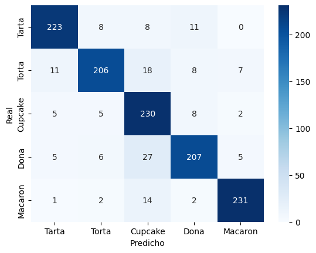

Clasificador de imágenes de pastelería con redes neuronales

Inteligencia Artificial II · Facultad de Ingeniería · Universidad Nacional de Cuyo

Trinidad Perea Enrico

# Resumen

Se implementó un clasificador de fotografías de pastelería en cinco clases (tarta, torta, cupcake, dona y macaron). Se comparó una CNN entrenada desde cero con MobileNetV2 preentrenada en ImageNet, primero con la base congelada y luego mediante fine-tuning. Sobre 1.250 imágenes de test, la CNN obtuvo 43,4% de accuracy y el modelo final 87,8%. Se integró el modelo en una interfaz Gradio. El ajuste fino no mejoró la accuracy de validación respecto de la etapa congelada.

# 1. Introducción y objetivos

El objetivo es aplicar aprendizaje supervisado de imágenes a una tarea concreta, comparar la generalización de diferentes estrategias de entrenamiento y analizar errores, no solo la exactitud global. El sistema devuelve una distribución softmax sobre cinco categorías conocidas; estas puntuaciones no garantizan probabilidades calibradas ni permiten detectar automáticamente objetos ajenos a las clases.

# 2. Fundamentos teóricos

## 2.1 Redes convolucionales

Una CNN aplica filtros compartidos sobre regiones locales de la imagen para aprender mapas de características. Las capas convolucionales extraen patrones visuales; ReLU aporta no linealidad; max pooling reduce resolución espacial; las capas densas combinan características para clasificar. El sobreajuste ocurre cuando el rendimiento en entrenamiento supera ampliamente al observado con datos no utilizados para ajustar pesos.

## 2.2 Transfer learning y MobileNetV2

Transfer learning reutiliza una representación visual aprendida en una tarea previa. MobileNetV2 es una CNN eficiente basada en bloques residuales invertidos y convoluciones separables en profundidad. Se cargaron pesos preentrenados en ImageNet, se retiró la clasificación original de 1.000 clases y se agregó una salida de cinco clases. Durante la primera etapa la red base permaneció congelada: solo aprendió la nueva cabeza.

## 2.3 Fine-tuning y regularización

En fine-tuning se habilitan parámetros de algunas capas preentrenadas para adaptarlas al dominio objetivo. Se usa una tasa de aprendizaje reducida para evitar cambios bruscos. Dropout, aumento de datos y early stopping son recursos para favorecer generalización. El aumento de datos se activa en entrenamiento, no en inferencia; el preprocesamiento de MobileNetV2 sí forma parte del flujo de predicción.

# 3. Dataset y preparación

Se utilizó Food-101 (Bossard et al., 2014), seleccionando:

\- apple_pie→Tarta

\- chocolate_cake→Torta

\- cup_cakes→Cupcake

\- donuts→Dona

\- macarons→Macaron

Cada clase aporta 750 imágenes oficiales de entrenamiento y 250 de test. Con random.seed(42), se mezclaron las rutas de cada clase y se separó el 85% para entrenamiento y el resto para validación, conservando el test oficial.

|               |           |       |
|---------------|-----------|-------|
| Conjunto      | Por clase | Total |
| Entrenamiento | 637       | 3.185 |
| Validación    | 113       | 565   |
| Test          | 250       | 1.250 |
| Total         | 1.000     | 5.000 |

Las imágenes se cargaron a 224 × 224 píxeles, en lotes de 32, mediante image_dataset_from_directory, con caché y prefetch. La categoría Torta corresponde específicamente a chocolate_cake, por lo que su alcance no incluye automáticamente cualquier tipo de torta.

Figura 1. Ejemplos de imágenes del conjunto de entrenamiento.

# 4. Metodología experimental

## 4.1 CNN entrenada desde cero

Arquitectura: entrada RGB 224×224; reescalado 1/255; tres convoluciones 3×3 de 32, 64 y 128 filtros con ReLU y max pooling; Flatten; Dense(128, ReLU); Dropout(0,5); Dense(5, softmax). Se entrenó 15 épocas con Adam y sparse categorical crossentropy. Se utilizó como línea base para medir el efecto de reutilizar pesos preentrenados.

## 4.2 MobileNetV2 congelada

Se cargó MobileNetV2 (include_top=False, weights=imagenet), con base.trainable=False. La entrada pasa por RandomFlip(horizontal), RandomRotation(0,1), RandomZoom(0,15), RandomContrast(0,1), preprocess_input, MobileNetV2 llamada con training=False, GlobalAveragePooling2D, Dropout(0,3) y Dense(5, softmax). Se utilizó Adam con learning rate 10⁻³, hasta 15 épocas y EarlyStopping(patience=4, restore_best_weights=True); se registraron 9 épocas.

## 4.3 Ajuste fino

Se estableció base.trainable=True, congelando todas las capas salvo las últimas 30; se recompiló con Adam y learning rate 10⁻⁵. Se continuó hasta 10 épocas, con EarlyStopping(patience=3, restore_best_weights=True); se registraron 4 épocas. La base se sigue invocando con training=False, detalle relevante para el comportamiento de capas como BatchNormalization. El modelo final guardado corresponde a esta etapa.

# 5. Resultados y discusión

|                           |                 |            |           |
|---------------------------|-----------------|------------|-----------|
| Configuración             | Entrenamiento\* | Validación | Test      |
| CNN desde cero            | 87,8%           | 42,3%      | 43,4%     |
| MobileNetV2 congelada     | 85,5%           | 84,4%      | No medido |
| MobileNetV2 + fine-tuning | 83,9%           | 83,7%      | 87,8%     |

\* Las cifras de entrenamiento corresponden al último valor registrado en los historiales; las cifras de validación de la CNN y del modelo final se evaluaron con evaluate, mientras que 84,4% de la etapa congelada es el máximo de su historial. No son mediciones homogéneas de un mismo checkpoint, por lo que deben interpretarse con esa salvedad.

La CNN mostró sobreajuste: la accuracy de entrenamiento subió hasta 87,8% mientras validación quedó en 42,3%, y su pérdida de validación aumentó. MobileNetV2 congelada elevó la accuracy de validación a 84,4%, reduciendo ampliamente la brecha. Fine-tuning no mejoró validación: 83,7% frente a 84,4%. No puede afirmarse que haya mejorado el test frente al modelo congelado, porque ese checkpoint no fue evaluado por separado en test.

El modelo final obtuvo 1.097 aciertos de 1.250 (87,76%). Que test supere validación podría relacionarse con el ruido del conjunto de entrenamiento de Food-101, del que procede validación, pero esa explicación no fue comprobada experimentalmente.

Figura 2. Evolución de accuracy de los tres entrenamientos.

Figura 3. Evolución de loss de los tres entrenamientos.

Figura 4. Accuracy conjunta de transfer learning y fine-tuning; la línea marca el cambio de etapa.

## 5.1 Métricas por clase

|         |           |        |      |         |
|---------|-----------|--------|------|---------|
| Clase   | Precision | Recall | F1   | Soporte |
| Tarta   | 0,91      | 0,89   | 0,90 | 250     |
| Torta   | 0,91      | 0,82   | 0,86 | 250     |
| Cupcake | 0,77      | 0,92   | 0,84 | 250     |
| Dona    | 0,88      | 0,83   | 0,85 | 250     |
| Macaron | 0,94      | 0,92   | 0,93 | 250     |

Precision indica qué proporción de predicciones de una clase fueron correctas; recall, qué proporción de ejemplos reales de esa clase se detectaron; F1 es su media armónica. Cupcake tiene recall de 92% pero precision de aproximadamente 77%, porque absorbe predicciones erróneas de otras clases. Macaron presenta el mayor recall exacto (231/250 = 92,4%).

## 5.2 Matriz de confusión

Figura 5. Matriz de confusión del modelo final sobre el test oficial.

La diagonal suma 1.097 aciertos y fuera de ella hay 153 errores. De estos, 67 fueron predicciones erróneas como Cupcake: 8 tartas, 18 tortas, 27 donas y 14 macarons. La confusión dona→cupcake (27) es la más numerosa.

# 6. Interfaz y pruebas externas

La aplicación Gradio carga el modelo guardado y la traducción de etiquetas desde clases.json. Redimensiona la imagen a 224×224 y muestra la distribución de salida por clase. El preprocesamiento de MobileNetV2 ya está incorporado al modelo; por eso no se debe aplicar otra normalización externa incompatible.

# 7. Limitaciones y mejoras futuras

El clasificador solo conoce cinco clases, no cuenta con una clase “otro” y puede asignar alta puntuación a imágenes ajenas al dominio. Torta está representada únicamente por chocolate_cake; Food-101 no representa toda la diversidad de productos artesanales. Las fotografías propias pueden diferir en iluminación, encuadre y presentación. Se propone reunir un test externo etiquetado, ampliar clases (por ejemplo, alfajor), explorar mecanismos de rechazo y evaluar por separado el checkpoint congelado para completar la comparación.

# 8. Conclusiones

El experimento muestra que la reutilización de características de ImageNet fue más eficaz que entrenar una CNN simple desde cero con 3.185 imágenes: la primera presentó sobreajuste y 43,4% de accuracy en test, mientras que el modelo final basado en MobileNetV2 alcanzó 87,8%. La etapa congelada obtuvo 84,4% de accuracy de validación y el fine-tuning posterior 83,7%, sin mejora demostrada. El análisis por clase revela errores concentrados en Cupcake. La interfaz demuestra la integración del modelo en una aplicación funcional, aunque se requiere una evaluación externa sistemática para estimar su desempeño en pastelería real.

# Referencias

Bossard, L., Guillaumin, M. y Van Gool, L. (2014). Food-101: Mining Discriminative Components with Random Forests. ECCV.

Sandler, M., Howard, A., Zhu, M., Zhmoginov, A. y Chen, L.-C. (2018). MobileNetV2: Inverted Residuals and Linear Bottlenecks. CVPR.

TensorFlow/Keras: documentación de MobileNetV2, image_dataset_from_directory y EarlyStopping. Gradio: documentación de interfaz de clasificación.

# 
